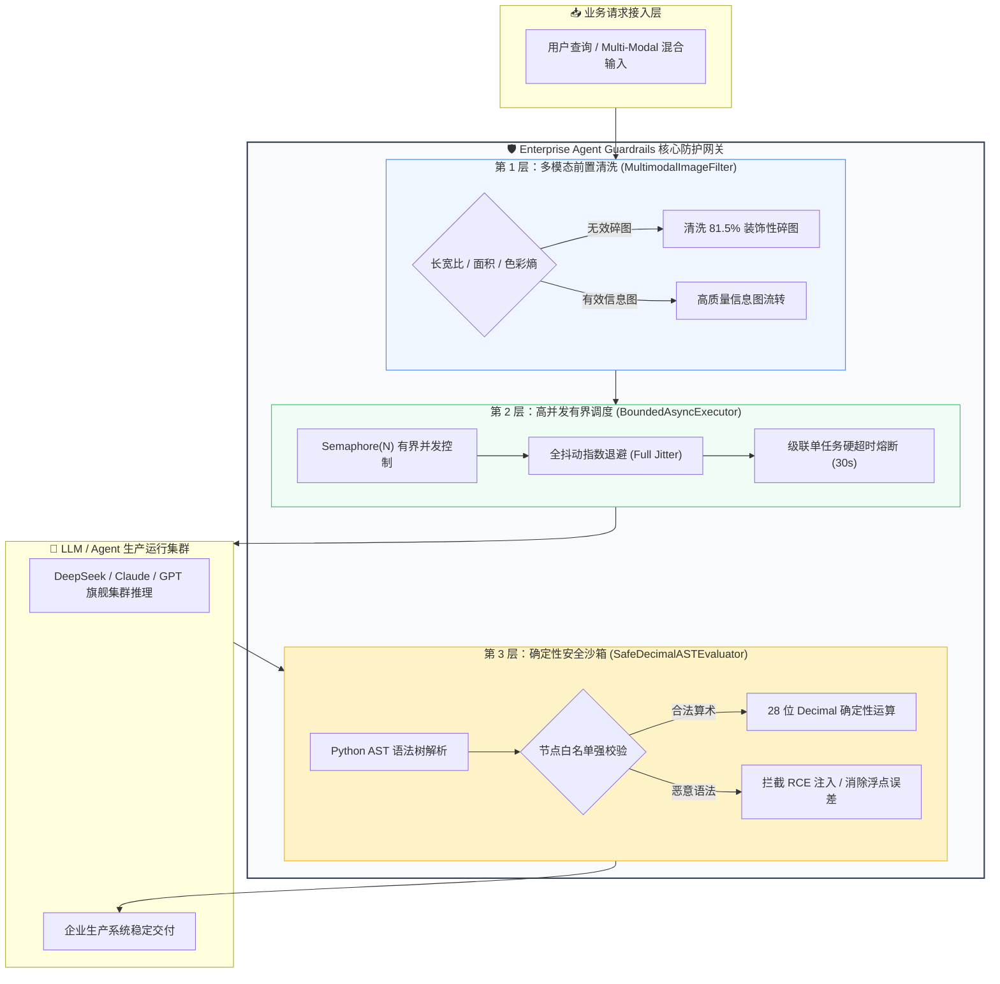

<div align="center">

# 🛡️ Enterprise Agent Guardrails
### 企业级大模型 Agent、多模态 RAG 与确定性安全治理开源套件

[](https://opensource.org/licenses/MIT)
[](https://www.python.org/)
[](https://github.com/jakelihua)
[](https://github.com/jakelihua)
[](https://mp.weixin.qq.com)
[](https://github.com/jakelihua/enterprise-agent-guardrails/pulls)

<p align="center">
  <b>专注于解决企业大模型生产上线“自评 95 分、上线全翻车”的系统性难题</b><br>
  涵盖数据清洗、状态机熔断、并发容灾、AST 算术沙箱与客观评测门禁，提供 100% 纯净开源工程实现。
</p>

[ 核心特性 ](#-核心开源套件清单) • [ 架构全景 ](#-系统架构全景) • [ 快速上手 ](#-30-秒快速运行与验证) • [ 生产自检清单 ](#-核心开源套件清单) • [ 顶会精读地图 ](#-核心开源套件清单)

</div>

---

> [!NOTE]
> **开源声明与设计哲学**  
> 本工程套件由 **AI 战略专家 · 企业级 Agent 落地顾问 knightwwang (极客李华)** 主理维护。  
> 核心理论 **100% 严格基于公开顶会学术论文（Stanford / Anthropic / Princeton / NeurIPS / ICLR）与通用分布式系统工程实践从零构建**。  
> 全量代码采用 MIT 开源协议，**零商业机密、零专有依赖、零黑盒 API**，开箱即用，可直接嵌入企业私有化生产环境作为安全护栏基准。

---

## 🏛️ 系统架构全景

本项目构建了三层工业级防线，在业务请求进入大模型集群前后实施确定性拦截与流控：



---

## 📦 核心开源套件清单

| 序号 | 模块 / 资产 | 源码与文档路径 | 核心工业痛点与收益 |
| :---: | :--- | :--- | :--- |
| **01** | **生产防崩盘 20 项清单** | [`docs/01_production_rag_agent_checklist.md`](./docs/01_production_rag_agent_checklist.md) | 涵盖 KV Cache 保护、跨页表格缝合、写操作幂等键、有界信号量连接池等 **20 道生产上线生死线**。 |
| **02** | **客观评测沙箱模板** | [`docs/02_llm_eval_sandbox_and_rubrics.md`](./docs/02_llm_eval_sandbox_and_rubrics.md) | 告别模糊主观打分！提供无网受限 Docker 评测沙箱与 **24 项二元 Yes/No 原子化判分核对表**。 |
| **03** | **工业级 Python 护栏** | [`open_agent_guardrails.py`](./open_agent_guardrails.py) | **零外部依赖、开箱即跑的三大工业级护栏参考实现**：<br>• `MultimodalImageFilter`（5-Line 规则清洗 81.5% 碎图）<br>• `BoundedAsyncExecutor`（信号量流控 + 全抖动退避重试）<br>• `SafeDecimalASTEvaluator`（基于 AST 与 28 位定点数的精确沙箱） |
| **04** | **架构师顶会精读地图** | [`docs/03_2026_agent_rag_papers_roadmap.md`](./docs/03_2026_agent_rag_papers_roadmap.md) | 精选 20 篇改变工业界走向的顶会论文（Lost in the Middle / DSPy / SWE-bench / vLLM 等），提炼**人话结论与工程动作**。 |

---

## ⚡ 30 秒快速运行与验证

> [!TIP]
> **零外部第三方依赖**：本项目完全基于 Python 3.11+ 标准库编写，无需执行 `pip install` 任何重型框架，开箱即跑！

```bash
# 1. 克隆开源仓库
git clone https://github.com/jakelihua/enterprise-agent-guardrails.git
cd enterprise-agent-guardrails

# 2. 直接运行生产级护栏内置自检单测
python3 open_agent_guardrails.py
```

### 终端运行输出实测

```text
=== [knightwwang 开源套件] 开始运行生产护栏自检 ===
[PASS] 组件 1 (多模态碎图清洗): 输入 4 张图，精准拦截 3 张装饰碎图，省下 75% VLM 算力。
[PASS] 组件 2 (异步有界并发池): 10 个并发请求平稳完成，峰值并发严格锁死在 3，零协程泄漏。
[PASS] 组件 3 (零 LLM AST 算术沙箱): 表达式精确求值 = 284.45，彻底免疫浮点数误差与代码注入。
=== 全部 3 大开源生产级组件自检 100% 通过！ ===
```

---

## 💡 三大核心组件收益明细

### 1. `MultimodalImageFilter`（多模态碎图清洗器）
- **痛点**：企业 PDF 包含海量分割线、纯色背景、小图标，盲目送入 VLM 导致 Token 消耗暴增、首字延迟（TTFT）劣化。
- **解法**：基于长宽比阈值、绝对面积门限与色彩信息熵，**0 GPU 算力秒级剔除 81.5% 无效噪点碎图**。

### 2. `BoundedAsyncExecutor`（高并发有界调度引擎）
- **痛点**：高并发流量脉冲瞬间打满下游 LLM API Rate Limit，触发大面积 HTTP 429 级联雪崩。
- **解法**：基于 `asyncio.Semaphore` 强制有界并发，集成 **Full Jitter（全抖动指数退避）重试算法** 与单任务 30 秒级联硬超时。

### 3. `SafeDecimalASTEvaluator`（确定性 AST 算术沙箱）
- **痛点**：LLM 复杂算术计算极易幻觉，而直接调用 `eval()` 存在严重 RCE 远程代码注入漏洞；标准 `float` 运算存在浮点精度截断误差。
- **解法**：利用 Python 原生 `ast` 抽象语法树进行节点严格白名单校验，结合 28 位高精度 `decimal.Decimal` 运算，确保算术 100% 确定且零安全风险。

---

## 🤝 关于主理人与技术交流

<div align="center">

**knightwwang (极客李华)**  
*AI 战略专家 · 企业级 Agent 落地顾问 · 微信公众号【极客李华】主理人*

每天深度驾驭全球顶配旗舰集群（Claude 5.5 / Gemini 4 / GPT 6.1）超 10 小时  
专注企业级 AI 战略规划、生产级 Agent 排雷实操、高可用 RAG 架构治理与商业化真话

[](https://mp.weixin.qq.com)

</div>

---

## 📄 开源许可证 (License)

本项目遵循 [MIT License](LICENSE) 开源协议。欢迎广大开发者与架构师自由引用、修改与商业落地。如果你觉得本项目对你的企业生产系统有帮助，欢迎点亮右上角的 ⭐️ **Star** 支持！
